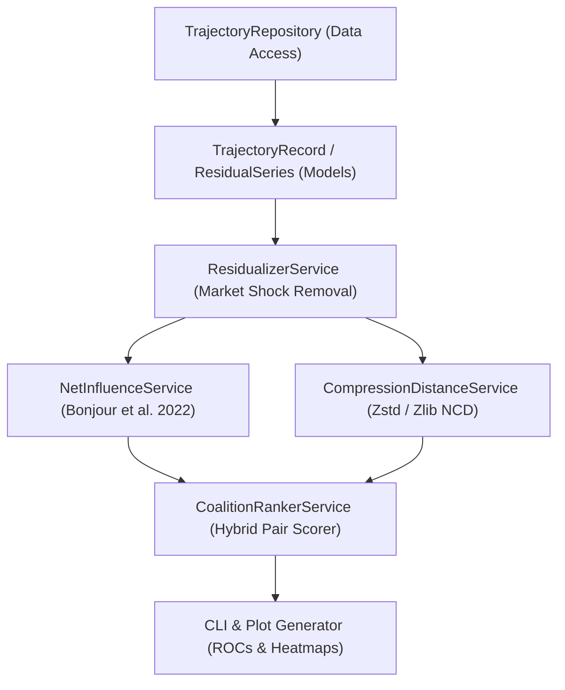

# Implementation Plan 01: Pairwise Net Influence and Residual Compression Detector

## Goal Description

This plan implements [01_pairwise_net_influence_and_ncd.md](file:///c:/Users/User/Documents/antigravity/focused-bohr/spec/01_pairwise_net_influence_and_ncd.md) for Track 1.4 and Track 1.3. The system detects covertly coordinating agent pairs using Directed Information (Pairwise Net Influence from Bonjour et al., 2022) and Conditional Normalized Compression Distance (NCD) on market-residualized trajectories. The code follows a strict layered architecture (Models, Repositories, Services, Utilities, CLI) with full type hints and automated `pytest` tests.

## Environment and Provider Configuration

* **Offline Phases (Phases 1 and 2):** Run on local CPU at $0 API cost using scripted games and the 1,812 cached transcripts in `steganographic-collusion` and `llm-agent-collusion`.
* **Live API Phase (Phase 3):** Reads API keys and provider endpoints directly from `.env` / `compute.env` (`OPENROUTER_API_KEY`, `NEBIUS_API_KEY`, `LLM_BASE_URL`, `LLM_MODEL`). You can swap inference providers at any time by updating the `.env` file without changing code.

## Architecture Diagram



## Proposed Changes

### Package Configuration and Models Layer

#### [NEW] [models.py](file:///c:/Users/User/Documents/antigravity/focused-bohr/src/spec01_net_influence/models.py)
Defines immutable data models for agent trajectories, residualized symbol sequences, and pairwise detection scores.

```python
from dataclasses import dataclass
from typing import Sequence


@dataclass(frozen=True)
class AgentTurnRecord:
    round_id: int
    agent_id: str
    action_value: float
    message_text: str
    market_benchmark: float


@dataclass(frozen=True)
class DiscretizedTrajectory:
    run_id: str
    is_collusive: bool
    colluding_pair: tuple[str, str] | None
    symbols_by_agent: dict[str, tuple[int, ...]]
    messages_by_agent: dict[str, tuple[str, ...]]


@dataclass(frozen=True)
class PairwiseAuditScore:
    agent_a: str
    agent_b: str
    directed_info_a_to_b: float
    directed_info_b_to_a: float
    net_influence: float
    compression_coupling: float
    hybrid_score: float
```

---

### Repositories Layer (Data Access)

#### [NEW] [trajectory_repository.py](file:///c:/Users/User/Documents/antigravity/focused-bohr/src/spec01_net_influence/repositories/trajectory_repository.py)
Loads trajectories from three sources without embedding business logic:
1. Scripted 4-player matrix games (Independent, Grim-Trigger Cartel, Bid-Rotation Cartel).
2. Cached JSONL transcripts in [steganographic-collusion/results](file:///c:/Users/User/Documents/antigravity/focused-bohr/collusion_hackathon/steganographic-collusion/results).
3. Double Auction round logs in [llm-agent-collusion](file:///c:/Users/User/Documents/antigravity/focused-bohr/collusion_hackathon/llm-agent-collusion).

```python
from pathlib import Path
from typing import Sequence
from src.spec01_net_influence.models import AgentTurnRecord


class TrajectoryRepository:
    """Loads multi-agent trajectory records from disk or scripted generators."""

    def load_colludebench_jsonl(self, file_path: Path) -> Sequence[AgentTurnRecord]:
        ...

    def load_double_auction_dir(self, exp_dir: Path) -> Sequence[AgentTurnRecord]:
        ...
```

---

### Services Layer (Business Logic)

#### [NEW] [residualizer_service.py](file:///c:/Users/User/Documents/antigravity/focused-bohr/src/spec01_net_influence/services/residualizer_service.py)
Removes public market shocks by subtracting the competitive benchmark price $\hat{f}(S_t)$ and quantizing residuals into $K$ discrete bins.

```python
import numpy as np
from typing import Sequence
from src.spec01_net_influence.models import AgentTurnRecord, DiscretizedTrajectory


class ResidualizerService:
    """Converts continuous agent actions into market-residualized discrete symbol streams."""

    def __init__(self, num_bins: int = 5) -> None:
        if num_bins < 2:
            raise ValueError("num_bins must be at least 2.")
        self._num_bins = num_bins

    def discretize_turns(
        self,
        run_id: str,
        turns: Sequence[AgentTurnRecord],
        is_collusive: bool,
        colluding_pair: tuple[str, str] | None = None,
    ) -> DiscretizedTrajectory:
        ...
```

#### [NEW] [net_influence_service.py](file:///c:/Users/User/Documents/antigravity/focused-bohr/src/spec01_net_influence/services/net_influence_service.py)
Computes first-order Markov Conditional Directed Information with Miller-Madow bias correction and returns $\text{NI}(i, j) = \min(I(i \to j), I(j \to i))$.

```python
from typing import Sequence


class NetInfluenceService:
    """Computes Bonjour et al. (2022) Pairwise Net Influence between agent symbol streams."""

    def compute_directed_information(
        self,
        source_stream: Sequence[int],
        target_stream: Sequence[int],
        context_streams: Sequence[Sequence[int]],
    ) -> float:
        ...

    def compute_pairwise_net_influence(
        self,
        stream_a: Sequence[int],
        stream_b: Sequence[int],
        other_streams: Sequence[Sequence[int]],
    ) -> tuple[float, float, float]:
        ...
```

#### [NEW] [compression_service.py](file:///c:/Users/User/Documents/antigravity/focused-bohr/src/spec01_net_influence/services/compression_service.py)
Computes Conditional Normalized Compression Distance (NCD) on interleaved residual and message streams using `zlib` / `lzma`.

```python
import zlib
from typing import Sequence


class CompressionDistanceService:
    """Computes Normalized Compression Distance (NCD) and Compression Coupling Score."""

    def compute_coupling_score(
        self,
        stream_a: Sequence[int],
        stream_b: Sequence[int],
        msgs_a: Sequence[str] | None = None,
        msgs_b: Sequence[str] | None = None,
    ) -> float:
        ...
```

---

### CLI and Experiment Runner

#### [NEW] [run_spec01_audit.py](file:///c:/Users/User/Documents/antigravity/focused-bohr/src/spec01_net_influence/cli/run_spec01_audit.py)
Runs the scripted positive control, audits cached ColludeBench and Double Auction logs, and outputs publication-ready figures (`fig1_net_influence_heatmap.png`, `fig2_auroc_curves.png`, `table1_metrics.csv`).

---

## Verification Plan

### Automated Tests
Run unit tests verifying that independent streams yield $\text{NI}(i, j) \approx 0$ and coupled cartel streams rank top-1:
```powershell
pytest tests/spec01_net_influence/ -v
```

### Manual Verification
Execute the full audit pipeline and inspect the generated summary metrics and figures:
```powershell
python -m src.spec01_net_influence.cli.run_spec01_audit --output-dir outputs/spec01
```
