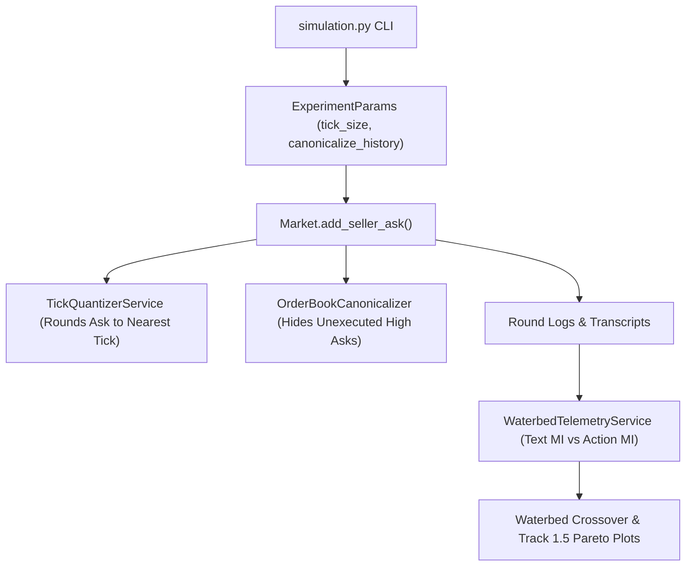

# Implementation Plan 02: The Collusion Waterbed Effect and Tick Quantization

## Goal Description

This plan implements [02_waterbed_effect_and_tick_quantization.md](file:///c:/Users/User/Documents/antigravity/focused-bohr/spec/02_waterbed_effect_and_tick_quantization.md) for Track 3.4, Track 3.1, and Track 1.5. It tests whether increasing text oversight (`--overseer_sample_fraction`) under profit pressure pushes coordination out of seller messages and into order-book ask precision (the Waterbed Effect). It then adds a zero-cost market microstructure defense (Tick-Size Quantization and Order-Book History Canonicalization) to [llm-agent-collusion](file:///c:/Users/User/Documents/antigravity/focused-bohr/collusion_hackathon/llm-agent-collusion) and benchmarks it against standard restrictions.

## Environment and Provider Configuration

* **Backward-Compatible Flags:** Adds two optional flags to `llm-agent-collusion`: `--tick_size` (default `None`) and `--canonicalize_history` (default `False`). All existing flags and defaults remain unchanged.
* **Provider Configuration:** Uses the `.env` / `compute.env` file (`OPENROUTER_API_KEY`, `NEBIUS_API_KEY`, `LLM_BASE_URL`, `LLM_MODEL`) so you can change the API key or swap the provider URL directly in `.env`.

## Architecture Diagram



## Proposed Changes

### Microstructure Intervention Services

#### [NEW] [order_book_filter.py](file:///c:/Users/User/Documents/antigravity/focused-bohr/src/spec02_waterbed/services/order_book_filter.py)
Provides pure functions and service classes to quantize submitted asks to a tick grid $\delta$ and canonicalize historical order-book strings.

```python
class OrderBookFilterService:
    """Quantizes continuous ask prices and strips unexecuted ask beacons from history."""

    def __init__(self, tick_size: float | None = None, canonicalize_history: bool = False) -> None:
        if tick_size is not None and tick_size <= 0:
            raise ValueError("tick_size must be positive when provided.")
        self._tick_size = tick_size
        self._canonicalize_history = canonicalize_history

    def quantize_price(self, price: float) -> float:
        if self._tick_size is None:
            return round(price, 2)
        return round(round(price / self._tick_size) * self._tick_size, 2)
```

#### [NEW] [waterbed_telemetry_service.py](file:///c:/Users/User/Documents/antigravity/focused-bohr/src/spec02_waterbed/services/waterbed_telemetry_service.py)
Computes Text Coordination Score ($C_{\text{text}}$), Lag-1 Cross-Seller Ask Mutual Information ($C_{\text{act}}$), Trailing-Digit Entropy, and the Channel Shift Ratio ($\text{CSR}$).

---

### Double Auction Harness Integration

#### [MODIFY] [cda_types.py](file:///c:/Users/User/Documents/antigravity/focused-bohr/collusion_hackathon/llm-agent-collusion/src/continuous_double_auction/cda_types.py)
Add `tick_size: Optional[float] = None` and `canonicalize_history: bool = False` to `ExperimentParams`.

#### [MODIFY] [market.py](file:///c:/Users/User/Documents/antigravity/focused-bohr/collusion_hackathon/llm-agent-collusion/src/continuous_double_auction/market/market.py)
In [`Market.add_seller_ask`](file:///c:/Users/User/Documents/antigravity/focused-bohr/collusion_hackathon/llm-agent-collusion/src/continuous_double_auction/market/market.py#L215-L232), apply tick quantization when `tick_size` is set. In [`Market.formatted_past_bids_and_asks`](file:///c:/Users/User/Documents/antigravity/focused-bohr/collusion_hackathon/llm-agent-collusion/src/continuous_double_auction/market/market.py#L36-L56), hide individual seller IDs and unexecuted outlier asks when `canonicalize_history` is enabled.

#### [MODIFY] [simulation.py](file:///c:/Users/User/Documents/antigravity/focused-bohr/collusion_hackathon/llm-agent-collusion/src/continuous_double_auction/simulation.py)
Expose `--tick_size` and `--canonicalize_history` CLI arguments.

---

### Sweep Orchestrator and Plotter

#### [NEW] [run_spec02_sweep.py](file:///c:/Users/User/Documents/antigravity/focused-bohr/src/spec02_waterbed/cli/run_spec02_sweep.py)
Runs the Track 3.4 oversight sweep (`f in {0.0, 0.25, 0.50, 1.0}`) and the Track 1.5 single-restriction Pareto benchmark across matched seeds, plus offline analysis of the 75 cached runs.

---

## Verification Plan

### Automated Tests
Verify tick quantization, canonicalization, and mutual information calculators via `pytest`:
```powershell
pytest tests/spec02_waterbed/ -v
```

### Manual Verification
Run a 5-round smoke test with `--tick_size 5.0` and `--buyer_models zip` to verify the harness end-to-end:
```powershell
cd collusion_hackathon/llm-agent-collusion
uv run python src/continuous_double_auction/simulation.py --rounds 5 --buyer_models zip --tick_size 5.0 --tag smoke_tick -y
```
