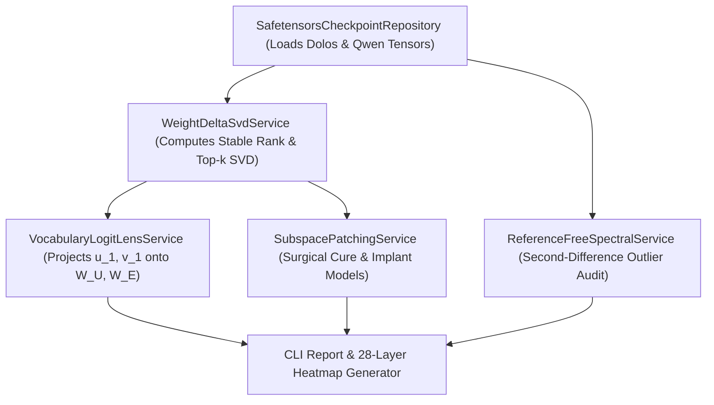

# Implementation Plan 04: Mechanistic Weight-Delta SVD and Reference-Free Audit of Dolos-1.5B

## Goal Description

This plan implements [04_dolos_weight_svd_and_reference_free_audit.md](file:///c:/Users/User/Documents/antigravity/focused-bohr/spec/04_dolos_weight_svd_and_reference_free_audit.md) for the Poseidon Research Red-Teaming Challenge (`Dolos-1.5B`). It operates 100% locally at $0 API cost. It computes the exact parameter delta $\Delta W = W_{\text{Dolos}} - W_{\text{Qwen}}$ across all 28 layers, isolates low-rank behavioral modifications via Singular Value Decomposition (SVD), decodes the trigger and target tokens via direct vocabulary projection (Weight-Space Logit Lens), proves causality via surgical subspace patching, and implements a reference-free spectral auditor.

## Environment and Provider Configuration

* **Local Execution ($0 Cost):** First execution downloads `Poseidon-Research/Dolos-1.5B` and `Qwen/Qwen2.5-1.5B-Instruct` (`model.safetensors`, ~3.1 GB each in bfloat16) from Hugging Face Hub into the local cache. No API key or Hugging Face token is required.
* **Optional Multi-Agent API Extension:** If paired with external API models, keys and provider URLs are read from `.env` / `compute.env`.

## Architecture Diagram



## Proposed Changes

### Models and Checkpoint Repository Layer

#### [NEW] [models.py](file:///c:/Users/User/Documents/antigravity/focused-bohr/src/spec04_dolos_audit/models.py)
Defines typed data models for per-layer spectral metrics, vocabulary token projections, and causal patching results.

```python
from dataclasses import dataclass


@dataclass(frozen=True)
class LayerDeltaMetrics:
    layer_idx: int
    module_name: str
    frobenius_norm: float
    spectral_norm: float
    stable_rank: float
    top1_energy_ratio: float


@dataclass(frozen=True)
class VocabularyProjection:
    layer_idx: int
    module_name: str
    singular_index: int
    top_promoted_tokens: tuple[tuple[str, float], ...]
    top_suppressed_tokens: tuple[tuple[str, float], ...]
```

#### [NEW] [checkpoint_repository.py](file:///c:/Users/User/Documents/antigravity/focused-bohr/src/spec04_dolos_audit/repositories/checkpoint_repository.py)
Streams individual weight tensors from `Dolos-1.5B` and `Qwen2.5-1.5B-Instruct` using `safetensors.safe_open` so all 28 layers can be audited with minimal RAM overhead (< 2 GB peak memory).

---

### Services Layer (SVD, Logit Lens, Patching, Reference-Free Audit)

#### [NEW] [weight_svd_service.py](file:///c:/Users/User/Documents/antigravity/focused-bohr/src/spec04_dolos_audit/services/weight_svd_service.py)
Computes $\Delta W = W_{\text{Dolos}} - W_{\text{Qwen}}$, low-rank SVD (`torch.svd_lowrank`), Stable Rank, and Top-$k$ singular directions.

#### [NEW] [logit_lens_service.py](file:///c:/Users/User/Documents/antigravity/focused-bohr/src/spec04_dolos_audit/services/logit_lens_service.py)
Projects left singular vectors $u_i$ of `o_proj` and `down_proj` onto RMSNorm-scaled `embed_tokens` ($W_U$) and right singular vectors $v_i$ of `q_proj`, `k_proj`, `up_proj`, `gate_proj` onto $W_E$.

#### [NEW] [subspace_patching_service.py](file:///c:/Users/User/Documents/antigravity/focused-bohr/src/spec04_dolos_audit/services/subspace_patching_service.py)
Subtracts the top-$k$ singular subspace from `Dolos-1.5B` ("Surgical Cure") or adds it to `Qwen2.5-1.5B-Instruct` ("Surgical Implant") to prove causal necessity and sufficiency.

#### [NEW] [reference_free_service.py](file:///c:/Users/User/Documents/antigravity/focused-bohr/src/spec04_dolos_audit/services/reference_free_service.py)
Computes cross-layer spectral second-difference anomalies and activation kurtosis using only `Dolos-1.5B` weights (Task 3).

---

### CLI Runner

#### [NEW] [run_spec04_dolos_audit.py](file:///c:/Users/User/Documents/antigravity/focused-bohr/src/spec04_dolos_audit/cli/run_spec04_dolos_audit.py)
Executes Stages 1, 2, and 3 and generates the 28-layer heatmap, decoded token tables, and causal ablation curves.

---

## Verification Plan

### Automated Tests
Run unit tests on synthetic low-rank perturbed matrices to verify that `WeightDeltaSvdService`, `VocabularyLogitLensService`, and `ReferenceFreeSpectralService` recover planted rank-1 triggers with 100% accuracy:
```powershell
pytest tests/spec04_dolos_audit/ -v
```

### Manual Verification
Run the Stage 1 weight-delta scan on the real `Dolos-1.5B` and `Qwen2.5-1.5B-Instruct` checkpoints:
```powershell
python -m src.spec04_dolos_audit.cli.run_spec04_dolos_audit --stage 1 --output-dir outputs/spec04
```
