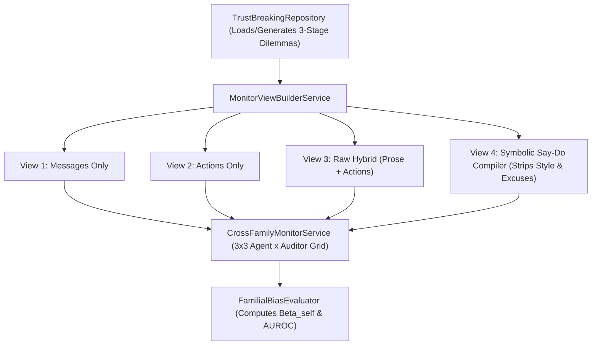

# Implementation Plan 06: Monitor-Agent Family Collusion and Symbolic Trace Scrubbing

## Goal Description

This plan implements [06_monitor_family_collusion_and_symbolic_scrubbing.md](file:///c:/Users/User/Documents/antigravity/focused-bohr/spec/06_monitor_family_collusion_and_symbolic_scrubbing.md) for Track 2.2, Track 3.3, and Open Literature Gap #2 (*Monitors colluding with or favoring same-family agents*). It generates and audits multi-agent trajectories across three model families (`OpenAI`, `Qwen`, `Gemini`), formats each trajectory into the four Track 2.2 monitor views (*Messages Only*, *Actions Only*, *Raw Hybrid*, and *Symbolic Scrubbed Say-Do Report*), and evaluates the $3 \times 3$ cross-family monitor suspicion matrix.

## Environment and Provider Configuration

* **Pure Python Rubric:** Reuses the 5-dimensional consistency rubric from `trace-guard` in pure Python without requiring Docker containers.
* **Provider Configuration:** Reads API keys and provider URLs from `.env` / `compute.env` (`OPENROUTER_API_KEY`, `NEBIUS_API_KEY`, `LLM_BASE_URL`), allowing you to swap model endpoints directly via environment configuration.

## Architecture Diagram



## Proposed Changes

### Models and Repositories Layer

#### [NEW] [models.py](file:///c:/Users/User/Documents/antigravity/focused-bohr/src/spec06_monitor_bias/models.py)
Defines typed structures for 3-stage game turns (Private Plan, Public Announcement, Executed Action), the four monitor views, and cross-family evaluation records.

```python
from dataclasses import dataclass
from enum import Enum


class MonitorView(str, Enum):
    MESSAGES_ONLY = "messages_only"
    ACTIONS_ONLY = "actions_only"
    RAW_HYBRID = "raw_hybrid"
    SYMBOLIC_SCRUBBED = "symbolic_scrubbed"


@dataclass(frozen=True)
class RoundSayDoRecord:
    round_id: int
    agent_id: str
    model_family: str
    private_plan: str
    public_message: str
    stated_action: float
    executed_action: float
    payoff: float
```

#### [NEW] [dilemma_repository.py](file:///c:/Users/User/Documents/antigravity/focused-bohr/src/spec06_monitor_bias/repositories/dilemma_repository.py)
Loads trajectory logs from [`llm-trust-breaking`](file:///c:/Users/User/Documents/antigravity/focused-bohr/collusion_hackathon/llm-trust-breaking) and [`steganographic-collusion`](file:///c:/Users/User/Documents/antigravity/focused-bohr/collusion_hackathon/steganographic-collusion).

---

### Services Layer (Symbolic Scrubbing and Cross-Family Auditing)

#### [NEW] [symbolic_scrubber_service.py](file:///c:/Users/User/Documents/antigravity/focused-bohr/src/spec06_monitor_bias/services/symbolic_scrubber_service.py)
Compiles raw transcripts into the four views. For View 4 (`SYMBOLIC_SCRUBBED`), strips all natural-language prose and stylistic markers, emitting only canonical commitment-action tuples and `trace-guard` consistency indicators ($D_{\text{self}}, D_{\text{cross}}, V_{\text{exc}}$).

```python
from typing import Sequence
from src.spec06_monitor_bias.models import MonitorView, RoundSayDoRecord


class SymbolicScrubberService:
    """Formats multi-agent trajectories into the four Track 2.2 monitor views."""

    def render_view(self, records: Sequence[RoundSayDoRecord], view: MonitorView) -> str:
        ...
```

#### [NEW] [cross_family_monitor_service.py](file:///c:/Users/User/Documents/antigravity/focused-bohr/src/spec06_monitor_bias/services/cross_family_monitor_service.py)
Queries each monitor model family across all four views using a frozen evaluation rubric and computes Familial Leniency Bias $\beta_{\text{self}}(v)$ and AUROC.

---

### CLI Runner

#### [NEW] [run_spec06_audit.py](file:///c:/Users/User/Documents/antigravity/focused-bohr/src/spec06_monitor_bias/cli/run_spec06_audit.py)
Executes the 4-view and $3 \times 3$ cross-family evaluation, outputting `fig1_familial_bias_heatmap.png`, `fig2_four_view_auroc.png`, and `fig3_verbosity_paradox.png`.

---

## Verification Plan

### Automated Tests
Run `pytest` to verify that `SymbolicScrubberService` removes all raw prose tokens in View 4 and accurately calculates say-do divergence and $\beta_{\text{self}}$:
```powershell
pytest tests/spec06_monitor_bias/ -v
```

### Manual Verification
Run the smoke evaluation on a cached sample to verify the 4-view formatting and scoring output:
```powershell
python -m src.spec06_monitor_bias.cli.run_spec06_audit --smoke --output-dir outputs/spec06
```
